# RotaPetro

### Learning from rotating rock thin sections

**Can a neural network identify mineral families better when it sees how a region changes under rotation, rather than seeing a single view?**

RotaPetro investigates this question using paired **plane-polarised light (PPL)** and **cross-polarised light (XPL)** microscopy. It connects image alignment, optical measurements, region segmentation, provisional labels and neural classification in one research workflow.

[Technical report — LaTeX](report/main.tex) · [Packaged report PDF](report/RotaPetro_Technical_Report.pdf) · [Run instructions](docs/RUNNING.md) · [Evidence and limitations](docs/EVIDENCE.md)

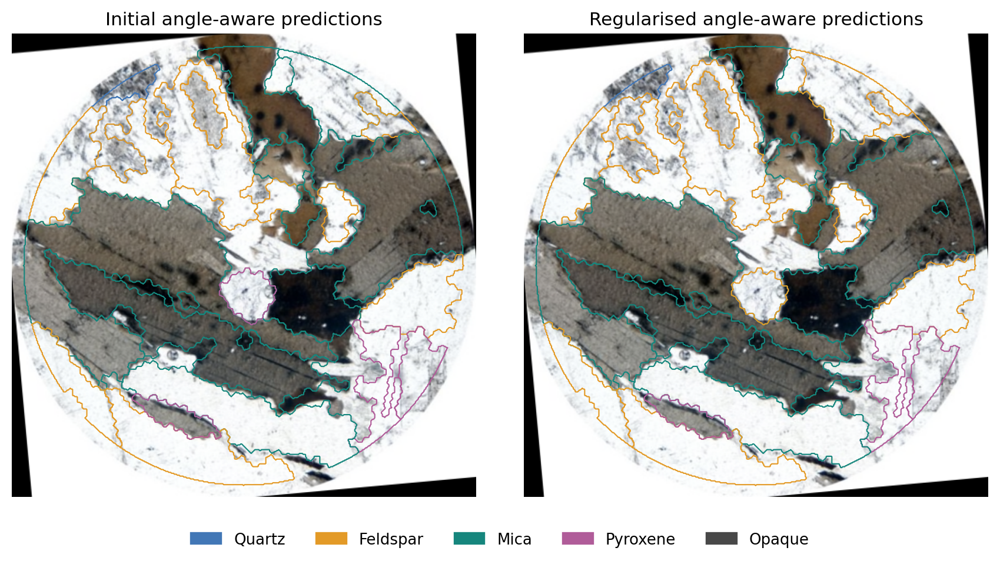

*Example final output: mineral-family predictions projected onto existing region boundaries. The neural network predicts a family for each region; it does not create these boundaries. Colours are predictions, not independently verified identities.*

> **Research status:** A working pipeline and 120 completed model fits across two experimental settings. The experiments **do not establish a reliable advantage from rotation over the designated single-view baseline**. Evaluation measures agreement with automatic weak labels, not expert-verified mineral accuracy.

## Why rotation?

A geologist does not examine a thin section using only one photograph. Rotating the microscope stage can reveal changes in colour, brightness, extinction and internal structure. These observations may help distinguish minerals that look similar in one view.

- **PPL** helps reveal colour, texture and changes in appearance under polarised illumination.
- **XPL** adds a crossed analyser and reveals optical behaviour such as changing interference colours and extinction.
- **Rotation-aware learning** asks whether combining observations at known angles improves classification.

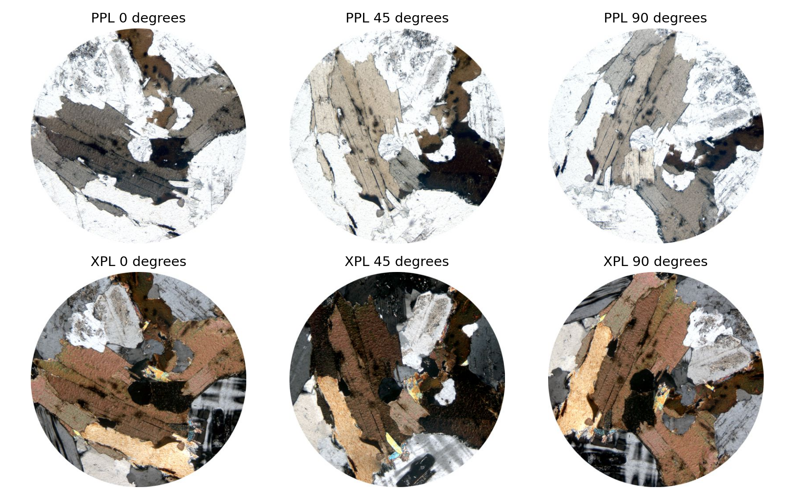

*Raw images are the starting point. Differences can reflect mineral optics, unwanted motion or acquisition changes; preprocessing must distinguish these effects.*

## From images to predictions

| Stage | What happens | Why it matters |
|---|---|---|
| Phase 0 — organise and check | Clean specimen/site records and check image sequences. | Establish which observations can be processed. |
| Phase 1 — align | Match landmarks and estimate robust geometric transformations. | Keep the same region at the same pixels across angles. |
| Phase 2 — optical maps | Measure angular brightness and colour changes. | Describe optical behaviour across the field. |
| Phase 3 — segment | Propose regions using image and optical information. | Define regions for measurement and classification. |
| Phases 4–5 — describe and organise | Extract region features and prepare sample/split records. | Connect regions to measurements and specimen identities. |
| Phases 6–7 — labels and checks | Apply rules, retain uncertainty and check target support. | Produce provisional supervision without forcing every region into a name. |
| Phase 8 — image embeddings | Encode region crops with frozen DINOv2. | Convert each image into a numerical visual description. |
| Neural training | Compare static, unordered and angle-aware classifiers. | Test the contribution of multiple views and angle information. |
| Phase 10 — evaluate | Compare held-out predictions with specimen-weighted metrics. | Measure generalisation and uncertainty. |

**Stages before neural training are preprocessing and rule-based analysis, not outputs of the trained classifier.**

### How many images does the model use?

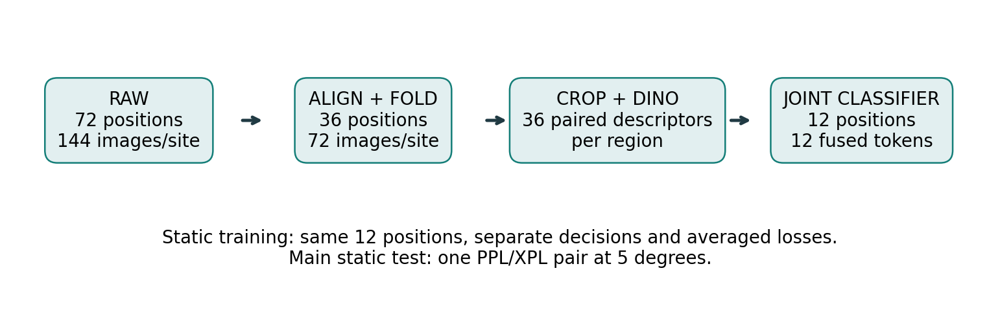

1. A complete site has **72 raw stage positions**, with PPL and XPL at each position: **144 photographs**.
2. After alignment, opposite-angle observations are averaged into **36 retained positions**, each still containing a PPL/XPL pair.
3. Image embeddings are computed for **all 36 retained positions**.
4. A multi-view decision uses **12 positions together**: 24 image descriptors, fused into 12 paired-view tokens.
5. The main static test uses **one PPL/XPL pair at 5°**. During training, the static model sees the same selected views independently, with their losses averaged.

**A full unaveraged 72-position / 144-image experiment is planned, not already demonstrated.** Averaging can reduce noise but can blur imperfectly aligned structures; its effect needs a controlled comparison.

## Follow one field through the pipeline

The example is **`granite_r1`**, selected for its readable saved intermediate outputs. It illustrates the workflow; it is not evidence that rotation always helps.

### 1. Align the observations

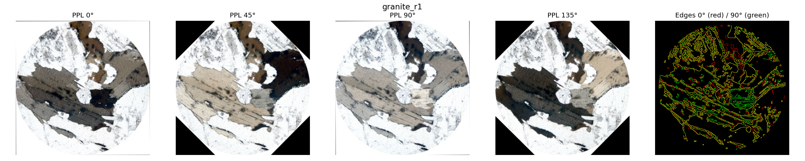

**ORB** finds and describes repeatable landmarks. **RANSAC** rejects inconsistent matches while estimating a geometric transformation. Rotating and shifting the images allows later stages to compare the same material across angles.

In the edge overlay, red and green represent edges from different observations. Coincident edges appear yellow; separated edges can reveal residual mismatch. Optical contrast changes can also affect which edges are detected.

### 2. Describe optical changes

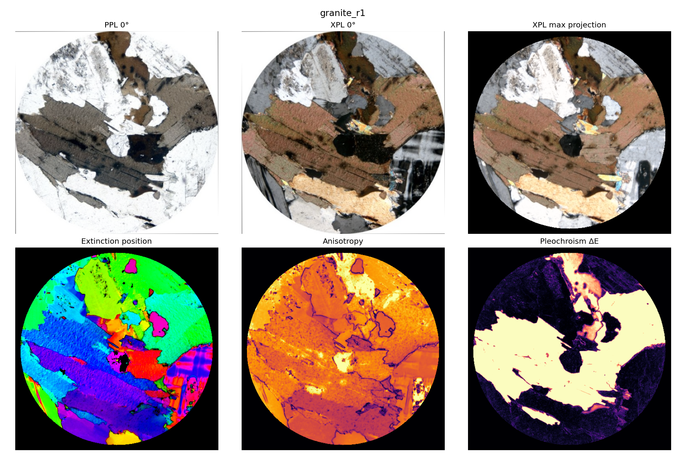

The maps summarise measurements such as the fitted extinction position, repeating XPL brightness variation and PPL colour variation. **Map colours encode measurements; they are not mineral names.**

### 3. Propose regions

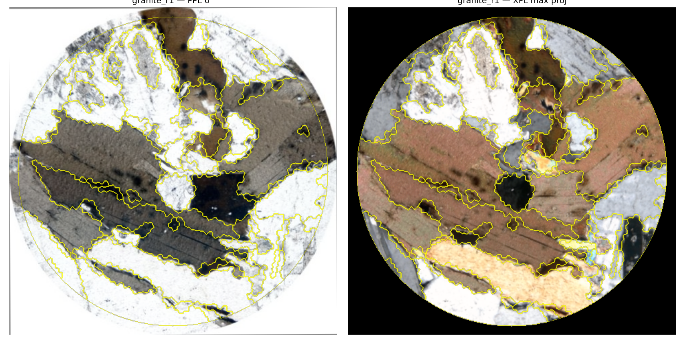

These are working region proposals. A physical grain can be split into several regions, and a region can contain mixed material. Segmentation quality affects both provisional labels and neural inputs.

<details>
<summary><strong>Explore selected regions, angular measurements and neural input crops</strong></summary>

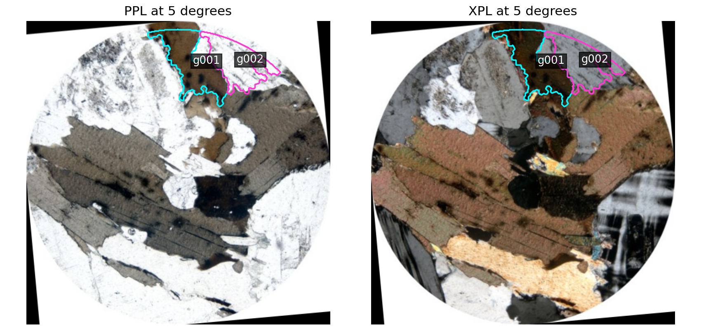

*Cyan marks `g001`; magenta marks `g002`. Both touch the valid-field boundary but retain substantial interiors for measurement.*

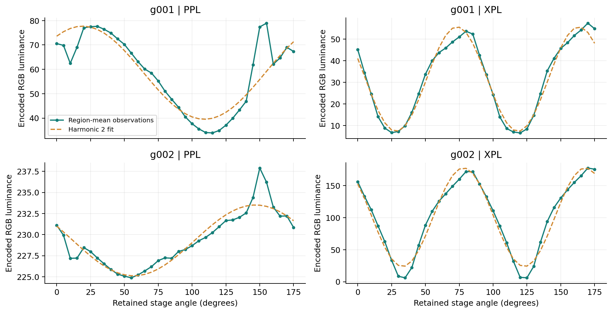

*Angular curves describe optical changes. A clear periodic response alone does not establish mineral identity.*

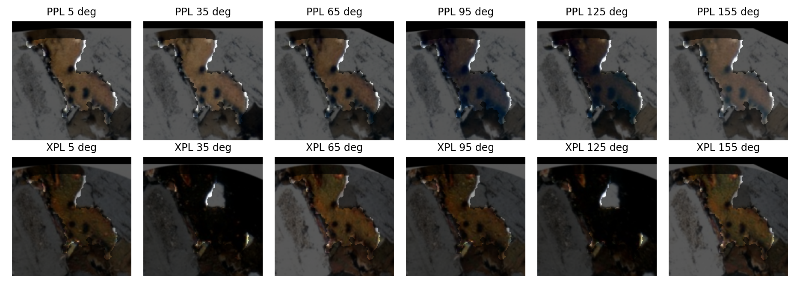

*Region `g001`: PPL above, XPL below. Six of the twelve test positions are displayed. Its provisional singleton target is mica.*

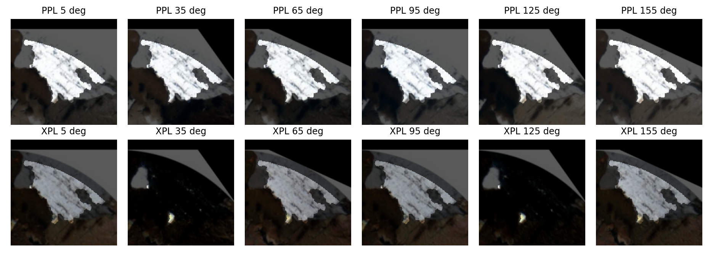

*Region `g002`: the rules abstain because the evidence does not justify one family. The network can still predict, but correctness is not established.*

</details>

## How the neural comparison works

A frozen **DINOv2 ViT-S/14** encoder converts each region crop into a descriptor. The workflow combines a global image token with mask-weighted patch features, then fuses PPL and XPL descriptors at each position.

The image encoder is **not fine-tuned** in these experiments. Trainable classifier heads learn five families from cached descriptors:

**Quartz · Feldspar · Mica · Pyroxene · Opaque material**

These are broad categories. Supported mica targets predominantly reflect biotite-like evidence rather than comprehensive coverage of all micas.

| Classifier | Test input | Purpose |
|---|---|---|
| Static | One PPL/XPL pair at 5° | Designated single-view reference |
| Unordered multi-view | Twelve paired views without explicit angle encoding | Test combining views |
| Angle-aware multi-view | Twelve paired views with angular encoding | Test whether known angles help |

The multi-view models use transformer attention to combine descriptors. The angle-aware model includes harmonic angle features; it **already receives angle information**. This is an angular sequence, not a time-series measurement of a changing specimen.

### Where do training labels come from?

An automatic teacher uses optical descriptors, rules and specimen mineral metadata. The network receives image-derived descriptors; optical maps and specimen lists influence the targets rather than being direct classifier inputs.

- **Singleton:** one supported family; train toward it.
- **Partial set:** several allowed families; train toward their combined probability without pretending one is known.
- **Abstention:** insufficient evidence; do not force an exact supervised label.

Nearly all non-opaque singleton targets depend on specimen metadata. This limits what model agreement can establish about actual mineral identity.

## Results

The initial setting contains **45 fits**: 3 models × 5 folds × 3 seeds. The regularised setting contains **75 fits**: 3 models × 5 folds × 5 seeds. Specimens are separated across held-out folds.

The primary comparison uses the same **581 singleton regions from 77 specimens**. Each represented specimen has equal total weight in the pooled confusion matrix, and macro-F1 gives each class equal importance.

| Model | Initial macro-F1 | Regularised macro-F1 |
|---|---:|---:|
| Static | **0.5309** | **0.4935** |
| Unordered multi-view | 0.5073 | 0.4724 |
| Angle-aware multi-view | 0.5308 | 0.4886 |

| Angle-aware minus static | Difference | 95% paired specimen-bootstrap interval |
|---|---:|---|
| Initial | −0.00004 | [−0.0449, +0.0461] |
| Regularised | −0.00493 | [−0.0219, +0.0121] |

**Both intervals include zero.** The experiments do not demonstrate an overall rotation advantage under the current preprocessing and weak targets. They also do not prove that rotation is uninformative or that DINO is the bottleneck.

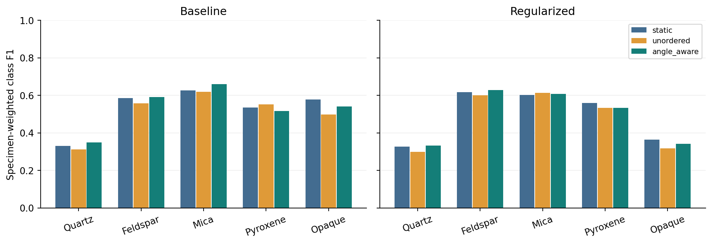

*Angle-aware point estimates exceed static for quartz, feldspar and mica in both settings, but decrease for pyroxene and opaque material. These class-level changes do not establish an overall gain.*

<details>
<summary><strong>Inspect class confusions and learning curves</strong></summary>

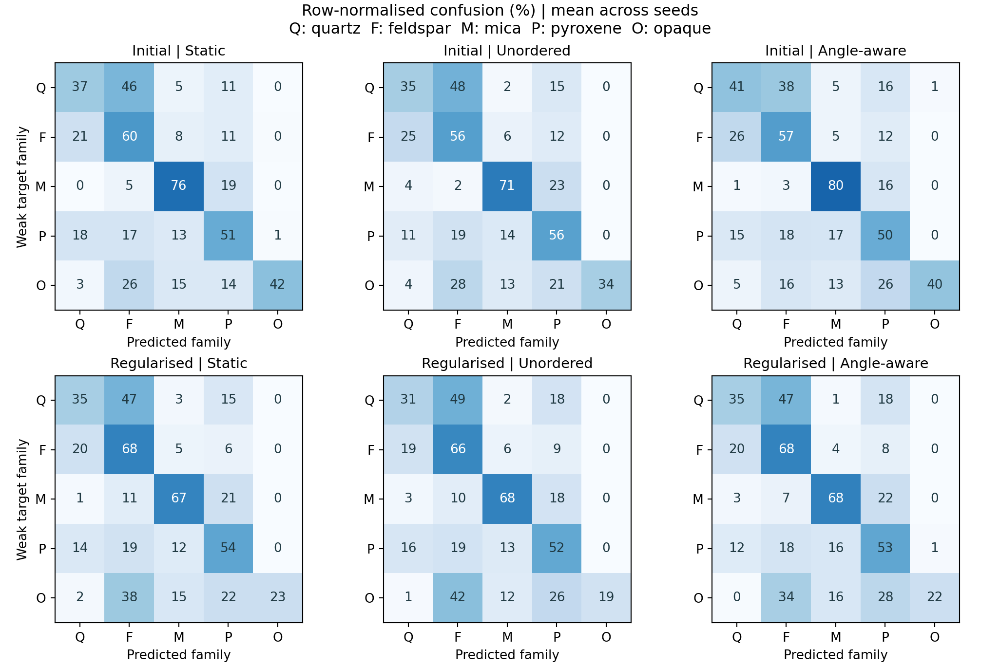

*Rows are automatic teacher targets; columns are predictions. Off-diagonal entries show teacher disagreement, not independently verified geological errors.*

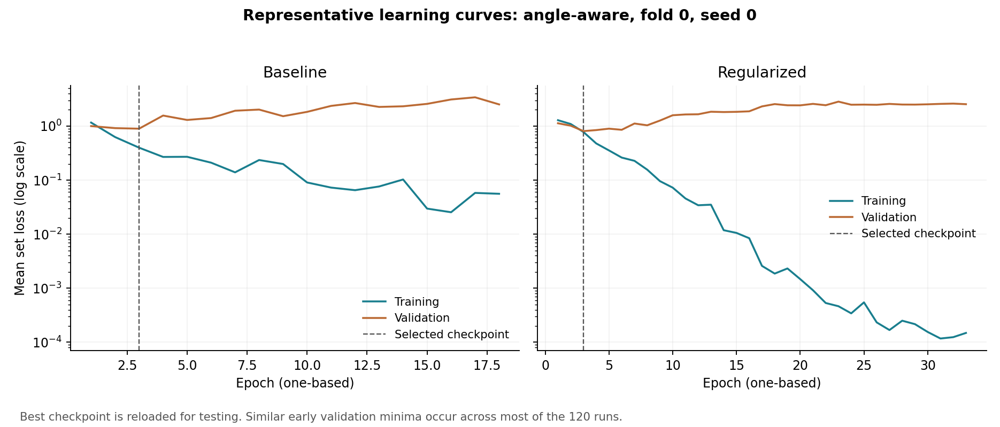

*Training loss can improve while validation loss worsens. Best-validation checkpoints are used for testing; more training epochs did not resolve generalisation.*

</details>

### What does the network output for an individual region?

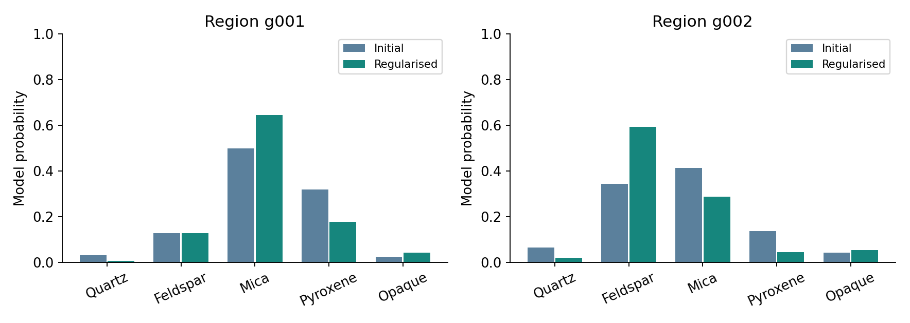

The output is a probability vector over five families. In the displayed held-out example, `g001` remains mica-like in both angle-aware settings. The preferred family for `g002` changes between settings. Its teacher abstained, so neither prediction is a confirmed identity. Probabilities are **uncalibrated model outputs**.

## What has been established, and what remains open?

**Completed:** an end-to-end research pipeline, visual intermediate outputs, uncertainty-aware weak supervision, specimen-separated comparisons and independent verification of saved prediction arithmetic.

**Still needed for stronger claims:** an independently reviewed test benchmark, quantitative boundary validation, controlled averaging/view-count experiments and better historical run provenance. More angles or a larger model cannot be assumed to improve performance.

Priority follow-up experiments:

1. Compare folded and unaveraged observations with fixed splits, targets and masks.
2. Compare optical-feature models and linear DINO heads with the transformer.
3. Measure the effects of registration errors, masks and surrounding context.
4. Evaluate view count, angular encoding, confidence calibration and abstention against independent targets.

## Repository layout

```text
.
├── README.md
├── report/
│   ├── main.tex                  # Editable technical report
│   ├── sections/                 # Chapters and equations
│   ├── images/                   # Figures displayed in this README
│   └── RotaPetro_Technical_Report.pdf
├── src/rotapetro/                # Pipeline and model implementation
├── scripts/                     # Phase entry points and training
├── configs/                     # Available configuration snapshot
├── knowledge/                   # Mineral knowledge and rule resources
├── tests/                       # Code checks
├── results/
│   ├── baseline/                # Initial predictions and summaries
│   └── regularized/             # Regularised predictions and summaries
├── evidence/                    # Feasibility, schemas, provenance and hashes
├── tools/reproduce_report_metrics.py
└── docs/                        # Execution and evidence notes
```

The LaTeX source includes the latest author and explanatory updates; the packaged PDF may be an earlier export. Compile `report/main.tex` for the current edition.

### Recheck the results — no GPU needed

From the repository root:

```bash
python -m venv .venv
# Linux/macOS: source .venv/bin/activate
# Windows PowerShell: .venv/Scripts/Activate.ps1
python -m pip install -r requirements-report.txt
python tools/reproduce_report_metrics.py
```

The verifier checks saved predictions, specimen/fold identities, matching targets across arms and primary mean F1 values. It does not retrain models or validate mineral labels. Bootstrap intervals come from archived evaluation; this utility verifies the underlying point estimates.

### Compile the report

With Tectonic installed:

```bash
cd report
tectonic main.tex
```

This produces `main.pdf`. Included figures allow compilation without raw stacks or a GPU. The LaTeX project can also be uploaded to Overleaf with `sections/` and `images/` intact.

### Run the research pipeline

Read [the execution notes](docs/RUNNING.md) first. Raw photographs, full preprocessing arrays, embedding caches, checkpoints and Python environments are **not included**. The `--v1` workflow skips Phases 0–3 and requires matching frozen preprocessing and splits.

The source snapshot is dated **28 October 2026**. It is not certified as the exact historical GPU checkout, and the complete historical regularised configuration was not preserved. Result figures use saved predictions; example crops use local reconstructions. See [the evidence notes](docs/EVIDENCE.md).

## Image attribution and reuse

Microscopy images derive from **The Open University Virtual Microscope collection**. Source and retained licence information appear in [THIRD_PARTY_NOTICES.md](THIRD_PARTY_NOTICES.md). Read [LICENSE_NOTES.md](LICENSE_NOTES.md) before reusing code or images; no blanket licence is applied to third-party material.

---

## Author

**Monesh Patidar**  
[moeshp23@iitk.ac.in](mailto:moeshp23@iitk.ac.in)

